<!-- 顶部横幅与个人介绍 -->

  

<h1 align="center">你好，我是 AttentionCoo 👋</h1>

  <strong>深度学习与 LLM 应用工程师 · Java 后端开发</strong> 
  关注计算机视觉、检索增强生成与多智能体系统，让研究走向可用的产品。

  

  
  
  
  

  <a href="#about">关于我</a> ·
  <a href="#projects">精选项目</a> ·
  <a href="#stack">技术栈</a> ·
  <a href="#activity">GitHub 动态</a>

---

## 🧑‍💻 关于我

- 🔭 **正在构建**：[MedLLM](https://github.com/AttentionCoo/stroke-multi-agent-cdss) 卒中临床辅助决策系统与 [LearnAgent](https://github.com/AttentionCoo/learning-characterizing-mas) 个性化医学教育系统。
- 🧠 **关注方向**：计算机视觉、LLM、Hybrid RAG、多智能体协作与后端工程。
- 🔬 **研究兴趣**：Transformer 架构、参数高效微调（PEFT）、模型量化、推理优化与多模态 AI。
- 📄 **论文成果**：1 篇论文被 CVPR 接收。
- 💬 **欢迎交流**：通过 [Issues](https://github.com/AttentionCoo/AttentionCoo/issues) 讨论研究、工程实践与项目想法。

<!-- 统一图片高度，保持原始比例 -->

  
  
  
  

---

## 📌 精选项目

### 🏥 [MedLLM · 脑卒中临床辅助决策系统](https://github.com/AttentionCoo/stroke-multi-agent-cdss)

面向脑卒中场景的临床辅助决策原型，以**证据检索 → 多专家协作 → 校验与医生复核**串联分析流程。

- **受控协作**：LangGraph 编排全科、神经专科与临床药师的独立意见、交叉质询与主持人共识。
- **证据溯源**：Hybrid RAG 融合语义与关键词检索，结合重排、证据充分性检查和有界重检索，报告引用文献与页码。
- **全栈交付**：Vue、Spring WebFlux 与 FastAPI 通过 SSE 展示分析阶段、专家意见、引用依据和报告。

`Vue 3` · `Spring Boot / WebFlux` · `FastAPI` · `LangGraph` · `ChromaDB / BM25` · `MySQL / Redis`

展开：领域工具与工程设计

- **领域工具**：支持 NIHSS、mRS、GCS 量表、溶栓时间窗、rt-PA 剂量与禁忌证筛查等评估工具。
- **患者记忆**：关联患者档案与历史评估，为连续就诊提供上下文。
- **流程控制**：结构化预评估、规则校验、有界反思循环与医生复核，保留审计记录。
- **质量验证**：分层自动化测试与可复现评测，持续检查检索质量和输出约束。

架构、部署与评测说明见[项目 README](https://github.com/AttentionCoo/stroke-multi-agent-cdss#readme)。

### 🎓 [LearnAgent · 个性化医学教育系统](https://github.com/AttentionCoo/learning-characterizing-mas)

面向脑卒中医学教育，以**画像 → 个性化学习 → 效果评估 → 反馈优化**组织学习闭环。

- **监督者调度**：Supervisor 通过 5 个工具动态调度检索、专家与报告生成，协同 10 位可寻址 Specialist Agent。
- **证据驱动画像**：8 维学习画像记录来源、置信度与证据状态，仅将有证据支撑的事实写入长期画像。
- **个性化学习**：贯通资源生成、路径规划、循证辅导与学习评估，将薄弱点反馈至画像和后续学习。

`Vue 3` · `Spring Boot` · `FastAPI` · `LangGraph / LangChain` · `ChromaDB` · `Qwen / VL` · `MySQL / Redis`

展开：专家协作与教学能力

- **专家协作**：结构化消息与共享黑板支持多专家会诊，Claim/Evidence 仲裁核对证据与结论。
- **资源生成**：支持课程讲解、思维导图、练习题、拓展阅读、临床案例与资源设计方案 6 类资源。
- **医学多模态**：支持影像分析、多图对比、DICOM 元数据以及检验报告与处方 OCR。
- **质量控制**：输入守卫、规则校验、反思修正与并发治理；Planner / RePlan 作为监督者的确定性回退链路。
- **代码辅助**：支持 Python 执行、代码补全、错误诊断与讲解。

中国软件杯 A3 赛题参赛作品。功能与架构说明见[项目 README](https://github.com/AttentionCoo/learning-characterizing-mas#readme)。

### ⚙️ 更多探索

| 项目 | 方向 | 核心实践 |
| :--- | :--- | :--- |
| [SuperBizAgent](https://github.com/AttentionCoo/super-biz-agent) | 企业助手与 AIOps | RAG 知识库、Plan-Execute-Replan 故障诊断、MCP 工具集成 |
| [Space-RAG](https://github.com/AttentionCoo/space-rag-model) | 天文知识问答 | 本地 PDF 与在线检索、多源知识融合、BM25 + M3E 混合检索 |
| [Titanic FT-Transformer](https://github.com/AttentionCoo/Titanic-FT-Transformer) | 表格深度学习 | 特征工程、FT-Transformer、DropPath、5 折交叉验证 |
| [Store Sales Forecasting](https://github.com/AttentionCoo/store-sales---time-series-forecasting) | 时间序列预测 | LightGBM、滞后与滚动特征、多源数据融合、时间切分验证 |

### 🛠️ 工具与积累

- [scrapy-ncbi](https://github.com/AttentionCoo/scrapy-ncbi)：面向 NCBI 文献与数据的异步 Scrapy 爬虫。
- [study-note](https://github.com/AttentionCoo/study-note)：AI / LLM、Java 后端、中间件与计算机基础学习笔记。
- [anime-gems](https://github.com/AttentionCoo/anime-gems)：动漫图片收藏。

---

## 🛠️ 技术栈

  

| 领域 | 技术与工具 |
| :--- | :--- |
| 机器学习与视觉 | PyTorch · TensorFlow · scikit-learn · OpenCV · Hugging Face |
| LLM 与智能体 | LangChain · LangGraph · LlamaIndex · Qwen · Ollama |
| 检索与知识库 | ChromaDB · Milvus · BM25 · Rerank · Hybrid RAG |
| 后端与数据 | Java · Spring Boot / Cloud · WebFlux · FastAPI · MyBatis · MySQL · Redis · MongoDB |
| 前端与部署 | Vue · Docker · Linux · Nginx |
| 数据分析 | NumPy · Pandas · Jupyter |
| 消息中间件 | Kafka · RabbitMQ |

---

## 📊 GitHub 动态

  
  

统计与奖杯卡片由 [GitHub Actions](.github/workflows/update-readme-widgets.yml) 每 12 小时定时更新。

🏆 展开 GitHub 奖杯

  

🔥 展开连续贡献记录

  

---

  <strong>用 AI 构建智能系统，让知识转化为行动。</strong> 
  <a href="https://github.com/AttentionCoo?tab=repositories">浏览我的项目</a> ·
  <a href="https://github.com/AttentionCoo/AttentionCoo/issues">交流想法</a>

  

